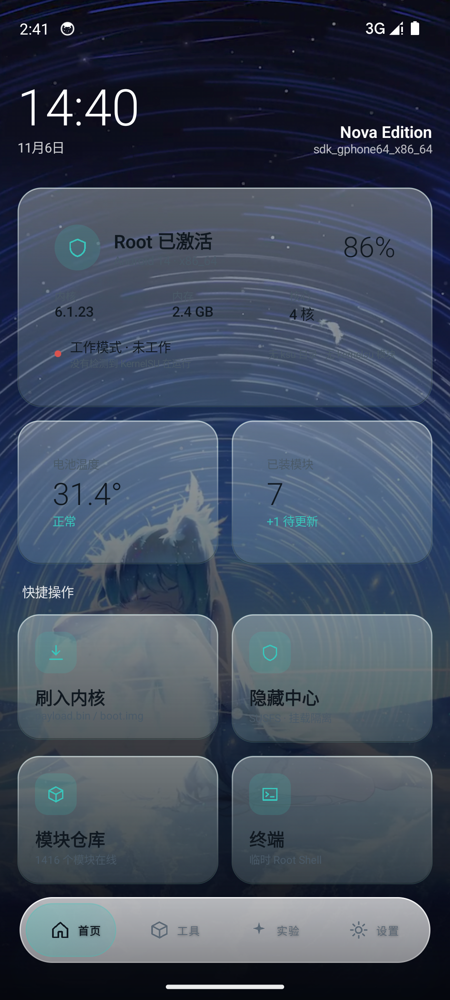
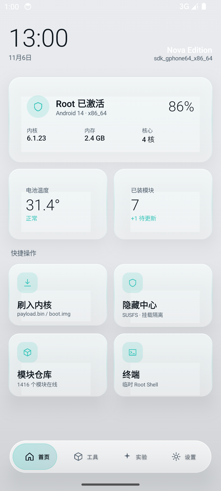
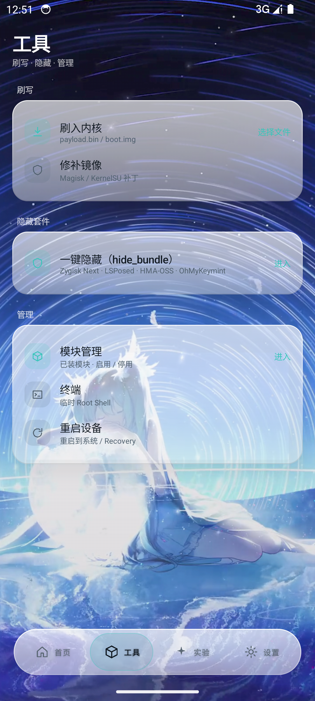
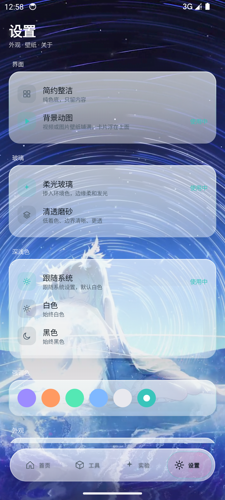
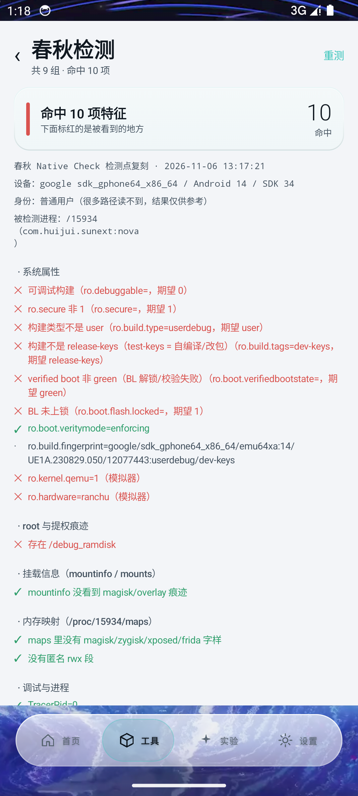
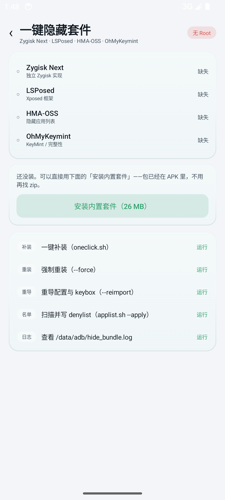
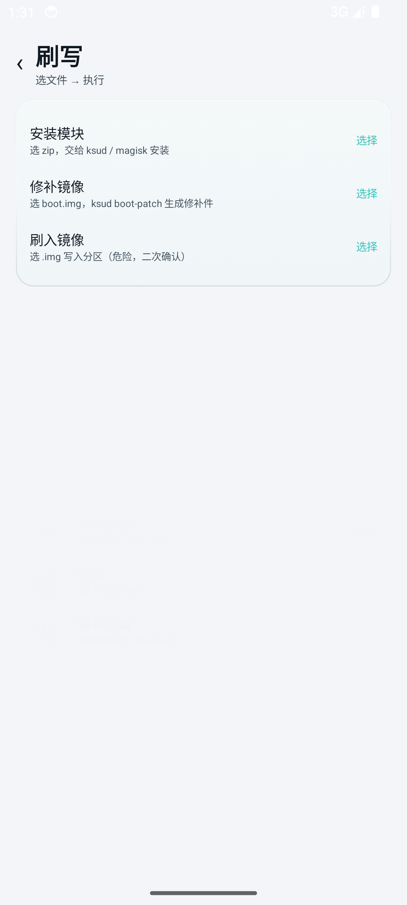
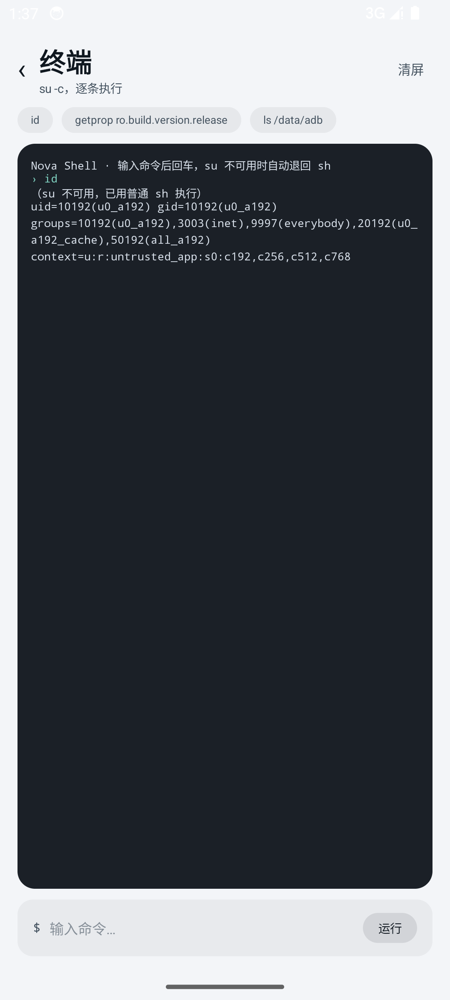

<div align="center">

# HuiJuiSU · Nova

**KernelSU 分支的管理器 · 独立 Compose 界面 · 内置检测与隐藏套件**

[](https://github.com/HuijuiSU-NEXT/HuijuiSU/releases)
[](LICENSE)
[](https://kotlinlang.org)
[](https://developer.android.com/jetpack/compose)

[下载](https://github.com/HuijuiSU-NEXT/HuijuiSU/releases) ·
[TG 群](https://t.me/Huijui123) ·
[QQ 群 763278354](https://qm.qq.com/q/763278354)

</div>

---

## 这是什么

HuiJuiSU 是 **KernelSU 的一个分支**，包含完整的内核模块（LKM）、`ksud`、以及一个重写过的 Android 管理器。

管理器里有**两套界面**：原有的经典界面，和这次完全重写的 **Nova**——它不依赖 Material3，全部由 Compose Foundation + [Miuix](https://github.com/compose-miuix-ui/miuix) 手写，配色、材质、动效都是自己的设计系统。

> 这不是换皮。`manager/huijuiui/` 是一个独立 Gradle 模块（namespace `com.huijui.nova`），零 `compose.material3` 依赖。

## 界面预览

| 首页（背景动图 + 柔光玻璃） | 简约整洁模式 |
|---|---|
|  |  |

| 工具页 | 设置 |
|---|---|
|  |  |

| 春秋检测 | 一键隐藏套件 |
|---|---|
|  |  |

| 刷写中心 | 终端 |
|---|---|
|  |  |

## 核心特性

### 界面

| 特性 | 说明 |
|---|---|
| **两种界面模式** | 简约整洁（纯色底，只剩内容）/ 背景动图（视频或图片壁纸铺满） |
| **两种玻璃材质** | 柔光玻璃（掺 5% 环境色，边缘发光）/ 清透磨砂（低着色，边界锐利） |
| **三种深浅色** | 跟随系统 / 始终白色 / 始终黑色 |
| **六种强调色** | 极光、熔岩、薄荷、冰川、石墨、初音 |
| **手势与动效** | 卡片按压回弹、页面切换淡入缩放、Dock 收起展开 |
| **深色适配** | 深色 + 动图模式自动压暗壁纸，文字全量转浅色 |

全屏子页面（检测/刷写/终端/模块）使用**完全不透明底 + 隐藏 Dock**，避免和底层内容重叠。

### 内置工具

| 工具 | 作用 |
|---|---|
| **春秋检测** | 复刻 9 组 native 检测点（系统属性 / root 痕迹 / 挂载 / maps / ptrace / SELinux / Zygisk / 模拟器 / 完整性），命中项标红 |
| **一键隐藏套件** | 集成 `hide_bundle`（Zygisk Next + LSPosed + HMA-OSS + OhMyKeymint），26 MB 安装包**内置在 APK 里**，支持补装/重装/重导配置/扫名单 |
| **模块管理** | 扫描 `/data/adb/modules`，展示名称/版本/作者，支持启用、停用、卸载（重启生效）、展开看描述 |
| **终端** | `su -c` 逐条执行，su 不可用自动退回 `sh`；快捷命令 + 等宽输出区 |
| **刷写中心** | 安装模块（ksud）/ 修补镜像（`ksud boot-patch`）/ 刷入分区（二次确认） |

### KSU 工作模式识别

首页实时显示当前 root 方案处于哪种形态：

| 状态 | 判定依据 |
|---|---|
| **未工作** | 无 `/data/adb/ksu`、无 `ksud` |
| **LKM 模式** | `/sys/module/kernelsu` 存在（内核模块已加载） |
| **GKI 内置** | 有 ksu 目录 + ksud，但无独立 module |
| **非 GKI / 补丁** | 只有 ksu 目录，老内核手工打补丁 |
| **未知** | 有 ksud 但特征不匹配 |

## 快速开始

### 1. 只装管理器

从 [Releases](https://github.com/HuijuiSU-NEXT/HuijuiSU/releases) 下载对应架构的 APK：

| 架构 | 适用 |
|---|---|
| `arm64-v8a` | 绝大多数现代手机 |
| `armeabi-v7a` | 老 32 位设备 |
| `x86_64` | 模拟器 / 部分平板 |
| `riscv64` | RISC-V 设备 |
| `universal` | 不确定时用这个（体积最大） |

### 2. 启用 Nova 界面

装上后从桌面图标「HuiJuiSU Nova」进入，或从主管理器的设置里切换。

首次进入建议：

1. 设置 → 界面 → 选「简约整洁」或「背景动图」
2. 设置 → 玻璃 → 柔光玻璃 / 清透磨砂
3. 设置 → 深浅色 → 跟随系统

### 3. 隐藏套件（可选）

工具 → 一键隐藏（hide_bundle）→ **安装内置套件（26 MB）**。

装完会自动：装 HMA 管理端、导入 HMA 配置和 keybox、应用 Zygisk Next 设置、生成黑白名单并写 denylist。

## 构建

需要 JDK 21 与 Android SDK（compileSdk 37）。

```bash
export JAVA_HOME=/usr/lib/jvm/java-21-openjdk-amd64
export ANDROID_HOME=$HOME/android-sdk
export ANDROID_NDK_HOME=$HOME/android-sdk/ndk/30.0.16248370

cd manager
./gradlew :app:assembleDebug        # 调试包
./gradlew :app:assembleRelease      # 发布包
./gradlew :huijuiui:testDebugUnitTest   # 45 个单测
```

> 构建注意：`gradle/libs.versions.toml` 里 `miuix-nav` 必须用 `miuix-nav-android` 变体，
> 否则 D8 会报 `PagerDragEvent is defined multiple times`。

CI 在 `.github/workflows/`：`build-manager.yml` 负责编译 APK / LKM / ksud，`release.yml` 负责打 tag 发版并推送 Telegram。

## 发布与通知

打 tag 即发布：

```bash
git tag v6.1 && git push origin refs/tags/v6.1
```

流水线会：编译 5 个架构的 APK → 创建 GitHub Release → 推送到 [TG 群](https://t.me/Huijui123)。

Bot 与通知链路的细节见 [docs/RELEASE_NOTIFY.md](docs/RELEASE_NOTIFY.md)。

## 目录结构

```
manager/                  Android 管理器
├── app/                  应用壳（经典界面 + Nova 入口）
│   └── src/main/assets/
│       ├── nova/         内置动态壁纸
│       ├── detect/       春秋检测脚本
│       └── hide/         hide_bundle 安装包
└── huijuiui/             Nova 界面模块（com.huijui.nova）
    └── src/main/kotlin/com/huijui/nova/
        ├── design/       设计系统（配色/排版/模式枚举）
        ├── miuix/        Nova 页面与玻璃卡
        ├── device/       设备信息、KSU 模式识别
        ├── detect/       春秋检测接入
        ├── modules/      模块管理
        ├── hide/         hide_bundle 接入
        └── wallpaper/    壁纸引擎

kernel/                   KernelSU 内核模块
userspace/                ksud 等用户态程序
```

## 已知限制

- **刷写与修补**需要真机和 root 才能验证，模拟器上只验证了界面流程与命令构造
- `universal` 包 72 MB，超过 Telegram Bot API 的 50 MB 限制，只能发下载链接
- 「模块仓库」里的在线数量是占位数据，没有接真实仓库接口
- 春秋检测是**等效复刻**，不是逆向原检测库；结论反映的是落盘/挂载/maps/进程/属性/SELinux 这几类特征

## 社区

- Telegram：https://t.me/Huijui123
- QQ 群：763278354
- 问题反馈：https://github.com/HuijuiSU-NEXT/HuijuiSU/issues

## 致谢

- 上游：[BakaSU](https://github.com/Baka-SU/BakaSU) / [KernelSU](https://github.com/tiann/KernelSU)
- UI 组件：[Miuix](https://github.com/compose-miuix-ui/miuix)（Apache-2.0）
- 动态壁纸素材：用户提供
- 图标：全部手写 24×24 路径

## 许可

[GPL-3.0](LICENSE)
