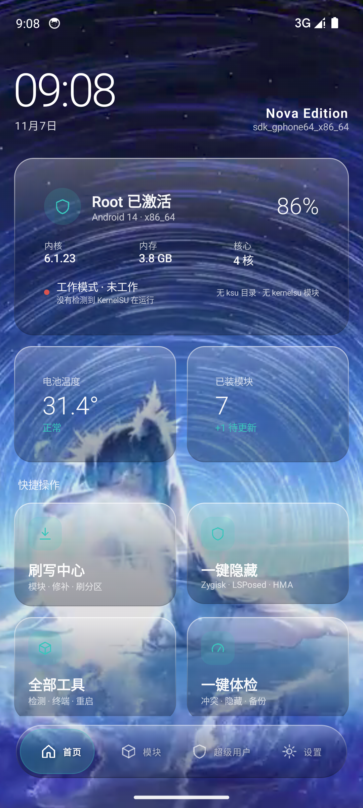
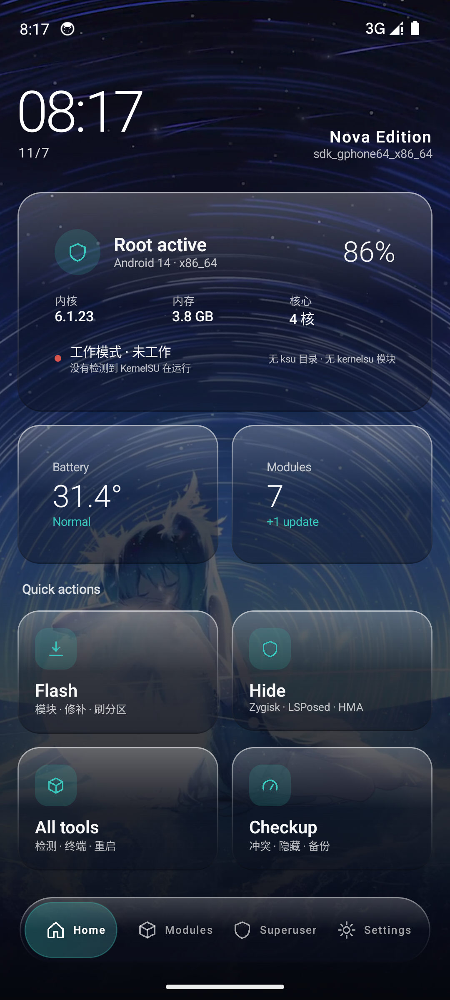

<div align="center">

# HuiJuiSU · Nova

**KernelSU 分支的 Android 管理器 · 自研 Compose 界面 · 内置检测 / 隐藏 / 自愈**

[](https://github.com/HuijuiSU-NEXT/HuijuiSU/releases)
[](LICENSE)
[](https://kotlinlang.org)
[](https://developer.android.com/jetpack/compose)
[](https://developer.android.com)

**简体中文** · [繁體中文](README.zh-TW.md) · [English](README.en.md) · [日本語](README.ja.md) · [한국어](README.ko.md) · [Русский](README.ru.md)

[下载](https://github.com/HuijuiSU-NEXT/HuijuiSU/releases) ·
[更新日志](https://github.com/HuijuiSU-NEXT/HuijuiSU/releases) ·
[TG 群](https://t.me/Huijui123) ·
[QQ 群 763278354](https://qm.qq.com/q/763278354)

</div>



---

## 这是什么

一个 **KernelSU 分支的管理器**，但不只是"能用"——它把 root 用户真正会踩的坑做成了内置能力：

- **不告诉你会出问题，而是直接修好**：体检找出模块冲突，自愈中心一键停用
- **不让你去论坛抄命令**：12 条 `resetprop` 补丁内置，点一下就生效
- **不假装支持**：没有的内核特性显示"不支持"，不会给你一个点了没反应的开关

界面完全自研，只依赖 Compose `foundation`，没有第三方组件库。

---

## 四项独有能力

| 能力 | 一句话 | 为什么别家没有 |
|---|---|---|
| **一键体检** | 5 项检查 + 0–100 评分 + 直达修复入口 | 别家只给清单，不给结论 |
| **自愈中心** | 模块冲突一键停用（可逆）+ 清理缓存 + 最近安装风险提示 | 别家不处理，只报告 |
| **补丁中心** | 12 条 `resetprop` 补丁，重启自动恢复 | 别家要你自己抄命令 |
| **4.x 兼容模式** | 非 GKI 内核的引导 + boot 修补工具链 | 别家直接不支持 4.x |

---

## 界面

四标签管理器结构，深色玻璃材质，动态壁纸背景。

| 首页 | Dock |
|---|---|
|  |  |

- **深色玻璃卡片**：顶部 26% 高光、中部透出壁纸、底边压暗
- **统一材质语言**：卡片、Dock、按钮同一套玻璃，没有塑料托盘感
- **排版**：时钟 52sp 负字距，正文两级灰阶，字距按层级区分
- **动态壁纸**：视频/图片铺满，卡片浮在上面，切换页面不丢壁纸
- **中 / 英切换**：196 条词典，持久化

---

## 功能一览

<details open>
<summary><b>管理器</b></summary>

- 四标签：首页 / 模块 / 超级用户 / 设置
- 模块：列表、启停、卸载、在线安装、本地 zip 安装
- 超级用户：授权列表、撤销（走内核 ioctl，失败回退改表）、按包名添加
- 设置：界面模式、玻璃材质、深浅色、强调色、壁纸、语言、内核设置、关于

</details>

<details>
<summary><b>工具</b></summary>

- **刷写中心**：安装模块 / 修补 boot / 刷入镜像（二次确认）
- **春秋检测**：9 组特征自检，标红暴露项
- **一键隐藏**：内置 hide-bundle 套件
- **SUSFS 面板**：总开关 / 日志 / AVC 伪造 / 隐藏路径 / 配置备份
- **内核设置**：su 兼容 / kernel umount / sulog / adb root / SELinux 隐藏
- **终端**：临时 root shell
- **在线模块仓库**：7 条镜像自动回退

</details>

<details>
<summary><b>独有</b></summary>

- 一键体检 · 自愈中心 · 补丁中心 · 4.x 兼容模式

</details>

---

## 内核支持

| 内核系列 | 支持方式 | 说明 |
|---|---|---|
| 6.x（6.6 / 6.12 / 6.18） | LKM | CI 构建 `kernelsu.ko` |
| 5.10 / 5.15 | LKM | CI 构建 `kernelsu.ko` |
| 4.x（4.9 / 4.14 / 4.19） | 内核补丁 | **不能用 LKM**，需设备内核源码 |
| 非 GKI 5.x | 内核补丁 | 同上 |

管理器会自动识别内核形态：未工作 / LKM / GKI 内置 / 4.x 非 GKI，并在首页显示。

---

## 安装

> **先确认内核类型**，再选路线。选错是“装了管理器却没有 root”的最常见原因。

| 你的内核 | 路线 |
|---|---|
| GKI 2.0（5.10 / 5.15 / 6.1 / 6.6 / 6.12 / 6.18） | **路线 A：LKM**（不需要重编内核） |
| 4.x 或非 GKI 魔改内核 | **路线 B：内核补丁**（需重编 boot） |

完整步骤、命令与排错见 👉 **[安装路线文档](docs/INSTALL_ROUTES.md)**

1. 到 [Releases](https://github.com/HuijuiSU-NEXT/HuijuiSU/releases) 下载对应架构
   - 不确定就选 `universal`
2. 覆盖安装即可（`applicationId` 固定，不丢数据）
3. 首次进入模块页需授予 root

| 架构 | 适用 |
|---|---|
| `arm64-v8a` | 绝大多数手机 |
| `armeabi-v7a` | 老 32 位设备 |
| `x86_64` | 模拟器 / 平板 |
| `riscv64` | RISC-V |
| `universal` | 不确定就用这个 |

---

## 从源码构建

```bash
# 管理器（需要 JDK 21 与 Android SDK 37）
cd manager
./gradlew :app:assembleRelease

# 内核模块与 ksud
cd userspace/ksud
cargo build --release --target aarch64-linux-android
```

CI 会自动构建 16 个 LKM 目标 + 4 个架构的 ksud。

---

## 和别家的差别

| | KernelSU | SukiSU | 本项目 |
|---|---|---|---|
| 模块管理 | ✅ | ✅ | ✅ |
| 超级用户 | ✅ | ✅ | ✅ |
| SUSFS | ❌ | ✅ | ✅ |
| 内核特性开关 | ✅ | ✅ | ✅ |
| KPM | ❌ | ✅ | ❌（内核未实现） |
| **一键体检** | ❌ | ❌ | ✅ |
| **自愈中心** | ❌ | ❌ | ✅ |
| **补丁中心** | ❌ | ❌ | ✅ |
| **4.x 兼容模式** | ❌ | ❌ | ✅ |
| **自研界面** | ❌ | ❌ | ✅ |

---

## 已知限制

- **安全模式**：开机音量键触发，内核层行为，管理器无写入接口
- **KPM**：本 fork 内核侧未实现加载器
- **多语言**：覆盖框架与常用项，长描述句仍为中文
- **4.x**：提供引导与工具链，编译内核仍需设备源码

---

## 链接

- [更新日志](https://github.com/HuijuiSU-NEXT/HuijuiSU/releases)
- [许可清单](docs/THIRD_PARTY_NOTICES.md)
- [真机验证清单](docs/VERIFY.md)
- [Telegram](https://t.me/Huijui123) · [QQ 群](https://qm.qq.com/q/763278354)

---

<div align="center">

**GPL-3.0** · 内核模块与管理器同源

</div>
