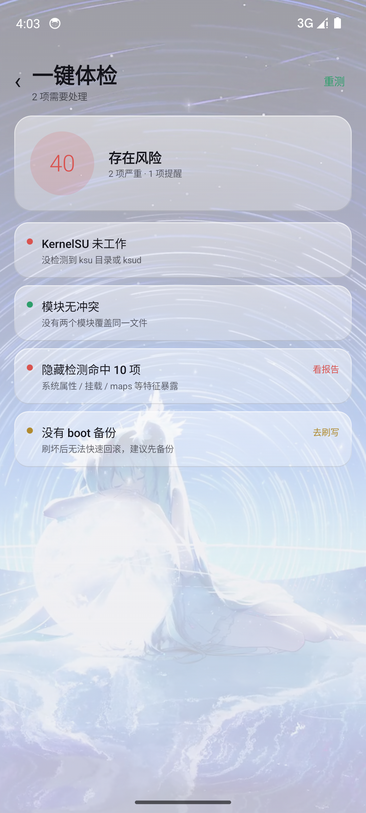
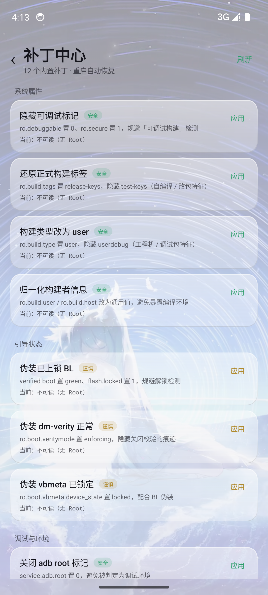
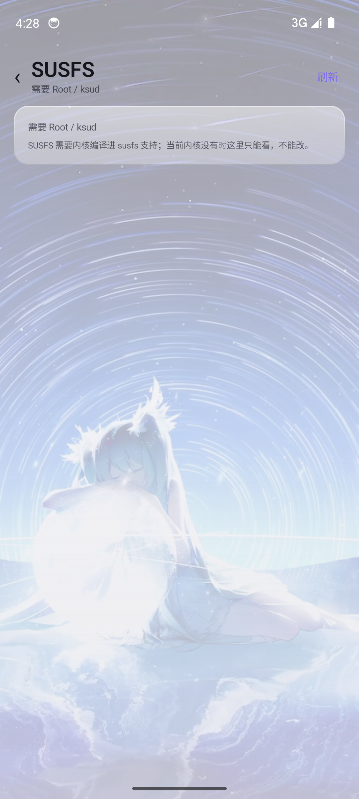
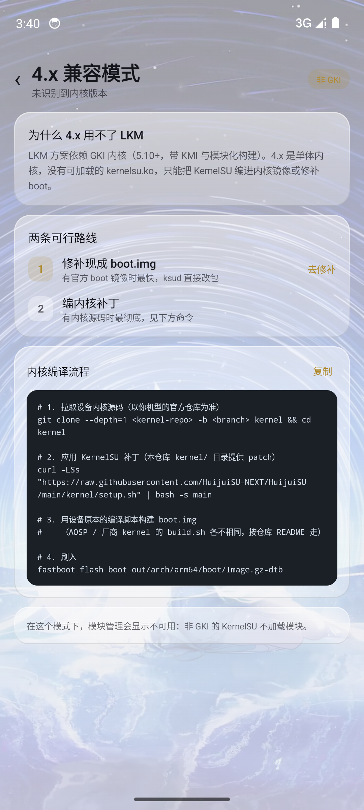

# HuiJuiSU NEXT Ultra v6.1

> 这一版最大的变化：**管理器被重写成 Nova 界面**，经典界面整体下线，release 构建链彻底修通。
> 同时带来四项独有能力：一键体检、自愈中心、补丁中心、SUSFS 面板。

## 一、界面：换掉第三方组件库

旧的 Nova 界面依赖 Miuix，它的 KMP 变体在 AGP 9 下会被 dex 两次，导致 **release 构建长期失败**。

这一版的处理：

- Nova 界面改为 **自研 NovaUI**，只依赖 Compose `foundation`
- 经典界面（131 个文件）整体下线，`MainActivity` 变成 15 行的 Nova 入口
- Miuix 依赖 **全部移除**
- 壁纸模式改用**深色玻璃**卡片：顶部高光 + 中部透出壁纸 + 底边压暗
- Dock 去掉 `shadow`（塑料感来源），换成同一套玻璃材质
- 时钟 52sp 负字距、品牌字距加宽、指标标签统一排版

| 玻璃材质 | Dock |
|---|---|
|  |  |

## 二、四项独有能力

### 1. 一键体检

同类管理器只给清单，这一版给**结论与评分**：

| 检查项 | 发现什么 |
|---|---|
| KernelSU 状态 | 未工作 / LKM / GKI / 4.x 非 GKI |
| **模块文件冲突** | 扫描每个模块的 `system/` 路径，找出两个模块覆盖同一文件（bootloop 最常见原因） |
| 隐藏检测 | 内联春秋检测，统计命中项 |
| boot 备份 | 是否存在可回滚的备份 |
| 模块数量 | ≥15 个时提示启动变慢 |

加权出 0–100 分，每项都带**直达修复入口**。

### 2. 自愈中心（新）

体检发现冲突后，这里直接**修好**：

- 一键停用每个冲突路径里后加载的模块（可逆，删 `disable` 恢复）
- 单模块停用 / 重新启用
- 清理 `/data/local/tmp` 与 ksu 日志
- 列出最近安装的模块，开机异常时优先停用

### 3. 补丁中心

12 条内置 `resetprop` 补丁，分四组，**重启自动恢复**，不写分区：

| 分组 | 补丁 |
|---|---|
| 系统属性 | 隐藏可调试标记、还原正式构建标签、构建类型改 user、归一化构建者 |
| 引导状态 | 伪装已上锁 BL、伪装 dm-verity、伪装 vbmeta 已锁定 |
| 调试与环境 | 关闭 adb root 标记、抹掉模拟器特征、恢复 ro.secure |
| 其他 | 重启使补丁失效、查看已修改属性 |

风险分级：安全 / 谨慎 / 危险，谨慎项弹确认框。

### 4. SUSFS 面板

把 `ksud susfs config` 的能力全部放开：

- 总开关、日志、AVC 日志伪造、隐藏 sus 挂载
- 隐藏路径增删（`sus_path add <path> --loop`）
- 配置导出与恢复默认

内核没编译 susfs 时如实提示「只能看不能改」。

## 三、4.x 非 GKI 兼容模式

针对 4.x 内核（不能加载 LKM）单独做的引导页：

- 说明为什么 4.x 用不了 LKM
- 两条路线：修补现成 boot.img / 编内核补丁
- 可直接复制的内核编译命令

## 四、其他改进

- **在线模块仓库**接入 `HuijuiSU-NEXT/Huijui_Module_Repo`，7 条镜像自动回退（GitHub / API / jsDelivr / ghproxy ×2 / gitmirror / ghproxy.cn）
- **中英切换**：196 条词典，持久化，重启保持
- **更新检查**：多镜像 + 6 小时缓存 + 按段比较版本号
- **包名**：`org.bakasu.bakasu` → `com.huijui.sunext`
- **版本号**：跟随 git tag 自动生成，不再写死
- **ksud** 新增 `profile revoke` 子命令（走内核 app_profile ioctl）
- 单启动图标：桌面只有一个 HuiJuiSU

## 五、内核支持范围

| 内核 | 方式 |
|---|---|
| 6.x（6.6 / 6.12 / 6.18） | LKM |
| 5.10 / 5.15 | LKM |
| 4.x（4.9 / 4.14 / 4.19） | 内核补丁，**不能用 LKM** |
| 非 GKI 5.x | 内核补丁 |

## 六、安装

1. 下载对应架构的 APK（不确定就用 `universal`）
2. 覆盖安装即可，`applicationId` 未变，不会丢数据
3. 首次启动直接进入 Nova 界面

## 已知限制

- 安全模式：由开机音量键触发，管理器无写入接口
- KPM：本 fork 内核侧未实现
- 多语言：覆盖框架与常用项，长描述句仍为中文
- 4.x 支持是「引导 + 工具链」，真机编译内核仍需设备内核源码

---

完整变更：`git log v6.0..v6.1`
